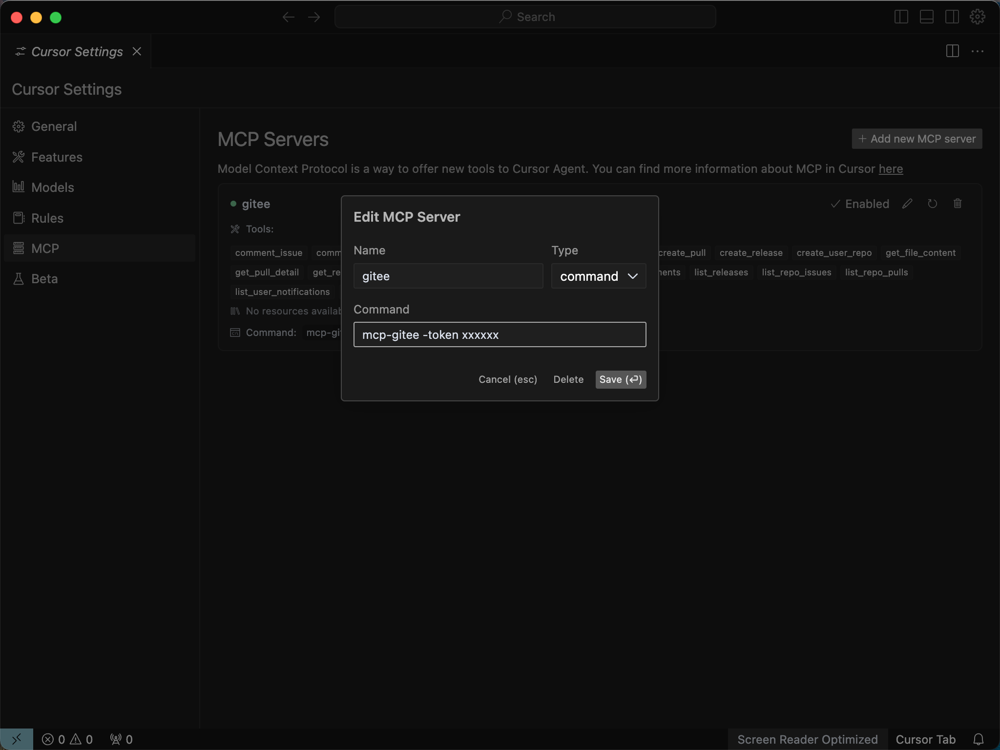

# 在 Cursor 中配置 mcp-gitee

根据 [Cursor MCP 文档](https://docs.cursor.com/context/model-context-protocol)，使用 JSON 配置：

```json
{
  "mcpServers": {
    "gitee": {
      "command": "mcp-gitee",
      "env": {
        "GITEE_API_BASE": "https://gitee.com/api/v5",
        "GITEE_ACCESS_TOKEN": "<your personal access token>"
      }
    }
  }
}
```

将此配置添加到以下位置之一：
- **项目级配置**: 在项目根目录下创建 `.cursor/mcp.json` 文件
- **全局配置**: 在你的主目录下创建 `~/.cursor/mcp.json` 文件

